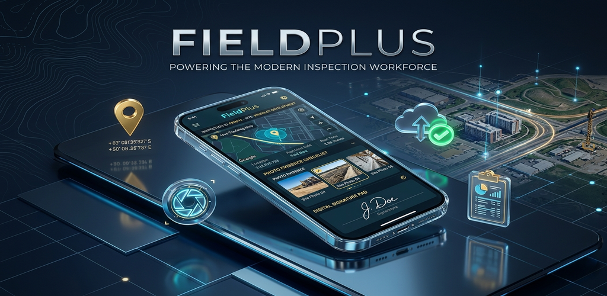
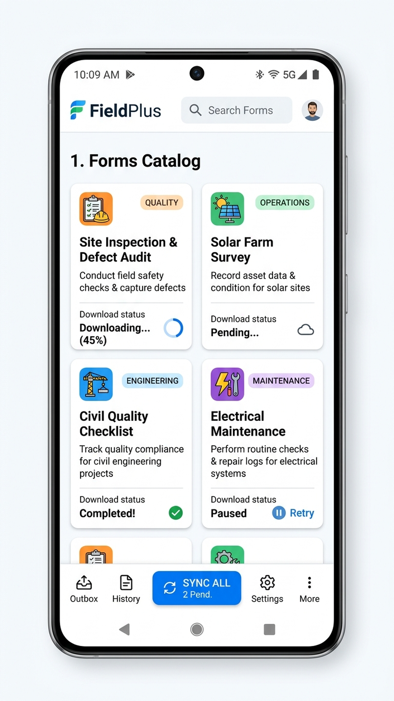
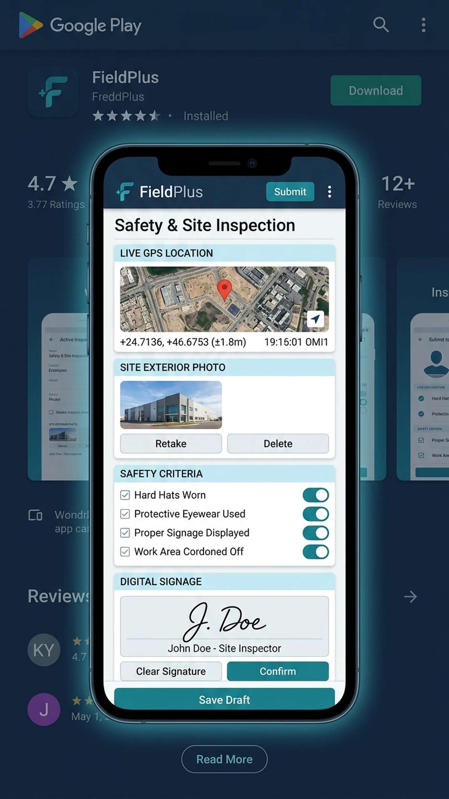
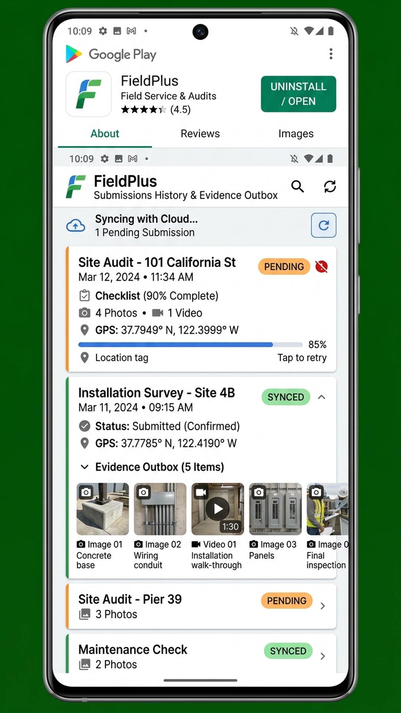
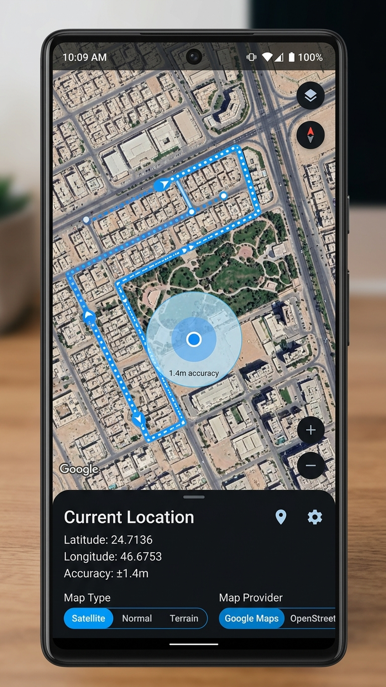
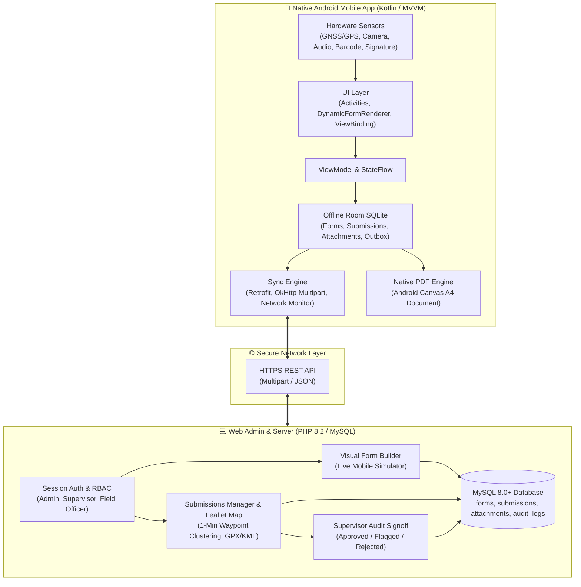

<div align="center">

# 📱 FieldPlus

### Enterprise-Grade, Offline-First Mobile Survey & Field Audit Platform
**Native Android (Kotlin • Material Design 3) & Full-Stack Web Admin (PHP 8.2 • MySQL • Leaflet)**

[](https://developer.android.com)
[](https://kotlinlang.org)
[](https://www.php.net)
[](https://www.mysql.com)
[](https://m3.material.io)
[](https://opensource.org/licenses/MIT)

<br/>



<br/>

[**🌐 Live Project Website**](https://el-capitano.github.io/FieldPlus/) • [**📱 Features**](#-key-features) • [**🗺️ GPS Telematics**](#-continuous-gps-tracking--telematics) • [**📊 Architecture**](#-system-architecture) • [**🚀 Quick Start**](#-quick-start-guide) • [**📄 Privacy Policy**](PRIVACY_POLICY.md)

</div>

---

## 🌟 Executive Overview

**FieldPlus** is an offline-first mobile survey, field inspection, and telematics audit platform built for field teams, site inspectors, utility engineers, and research surveyors operating in remote environments with zero or intermittent internet connectivity.

Inspired by industry standards like **ODK Collect** and **KoboToolbox**, FieldPlus bridges field inspections and operational management by combining:
1. **A 100% Native Kotlin Android Application** with an offline-first Room database, dynamic JSON form rendering, multi-sensor hardware capture (GNSS/GPS, Camera, Video Walkthrough, Barcode/QR, Audio Memos, and Vector Digital Signature), continuous route logging with milestone clustering, and background multipart sync.
2. **A Web Admin Portal & Operations Dashboard** built in modern PHP 8.2 and MySQL with a drag-and-drop Visual Form Builder, live phone emulator, supervisor audit signoff workflow, Leaflet telematics mapping, and GPX/KML/GeoJSON export.

---

## 📸 Visual Showcase

<div align="center">
<table>
  <tr>
    <td align="center" width="25%">
      <b>Forms & Audits Catalog</b><br/><br/>
      
    </td>
    <td align="center" width="25%">
      <b>Dynamic Field Inspection</b><br/><br/>
      
    </td>
    <td align="center" width="25%">
      <b>Evidence & Outbox Sync</b><br/><br/>
      
    </td>
    <td align="center" width="25%">
      <b>Continuous GPS Telematics</b><br/><br/>
      
    </td>
  </tr>
</table>
</div>

---

## 🚀 Key Features

### 📱 1. Native Android Mobile Client (`android/`)
* **100% Native Kotlin & Material 3**: Built with Kotlin Coroutines, StateFlow, Room Persistence, ViewBinding, and clean MVVM architecture targeting Android 16 (API 36).
* **Dynamic Form Rendering Engine (`DynamicFormRenderer`)**: Parses JSON form schemas dynamically received from the server and instantly renders native Android UI widgets with field validation, required toggles, and live conditional logic.
* **Offline-First Room SQLite Architecture**:
  * Form templates, active surveys, drafts, and outbox queues are stored locally in Room.
  * Field officers can start, save as draft, resume, and submit audits completely offline.
  * Media files (photos, signature vector captures, audio memos, video clips) are stored in sandboxed app storage and linked via database entities.
* **Resilient Background Synchronization**:
  * One-touch sync or automatic background outbox dispatcher.
  * Reliable HTTP/2 multipart upload with token authentication, payload splitting, and retry logic.
  * Automatically marks surveys as `SYNCED` upon verified server acknowledgement.
* **Native PDF Inspection Report Generator (`PdfReportGenerator`)**:
  * Generates branded, multi-page A4 inspection certificates directly on-device using Android's native `PdfDocument` canvas.
  * Includes customer metadata, survey question matrices, high-resolution evidence thumbnails, vector digital signatures, and an embedded route map snippet.
  * Direct Android Sharesheet integration for instant sharing via WhatsApp, Email, or Google Drive.

### 🛰️ 2. Continuous GPS Tracking & Telematics Engine
* **High-Precision Multi-Source GNSS**:
  * Concurrently monitors Google Play Services `FusedLocationProviderClient` and Android OS `LocationManager` (`GPS_PROVIDER` + `NETWORK_PROVIDER`) with accuracy filtering.
* **Intelligent 1-Minute Milestone Clustering**:
  * Logs high-frequency telematics (sub-second fixes) in the database while automatically clustering directional arrows and milestone pins to **1-minute intervals** on the map, ensuring zero visual clutter while preserving 100% of route curvature.
* **Directional Vectors & Bearings**:
  * Computes true forward azimuth/bearing angles ($0^\circ - 360^\circ$) and renders rotated directional arrows along the path.
* **Interactive Telematics Log & Transient Focus**:
  * Complete waypoint table with speed ($km/h$), leg distance, altitude, accuracy, and timestamp.
  * Clicking any point in the log centers the map and displays an interactive inspection popup.
* **Multi-Format Route Export**:
  * One-click export to **GPX** (Garmin / Strava / GPS devices), **KML** (Google Earth 3D flyovers), and **GeoJSON** (QGIS / ArcGIS / GIS analytical tools).
  * Native map provider chooser (Google Maps driving route, OpenStreetMap navigation, or single pin).

### 💻 3. Full-Stack Web Admin Portal (`web-admin/`)
* **Visual Drag-and-Drop Form Builder (`form_builder.php`)**:
  * Build complex surveys with sections, helper text, custom variable keys, required flags, and input constraints.
  * **Live Mobile Simulator Panel**: Real-time interactive phone emulator previewing how the form renders on Android as you build it.
* **Supervisor Verification & Audit Signoff (`submission_detail.php`)**:
  * Formal audit review workflow with decision statuses: `⏳ Pending Review`, `✅ Verified & Approved`, `⚠️ Flagged for Clarification`, and `❌ Rejected`.
  * Audit notes, timestamp tracking, and immutable audit logs (`audit_logs.php`).
* **Role-Based Access Control (RBAC)**:
  * Multi-tiered permission system: `Admin` (full system control & user management), `Supervisor` (form authoring & submission verification), and `Field Officer` (mobile data collector).
* **OpenStreetMap & Leaflet Telematics View**:
  * Interactive route playback with tile switching (OpenStreetMap, CartoDB Positron, CartoDB Dark Matter, and Satellite imagery).
* **Data Export & Reporting**:
  * Instant bulk export to CSV and formatted JSON for data analysts and statistical pipelines (SPSS, R, Pandas, PowerBI).

---

## 📋 Comprehensive Survey Widgets Supported

| Widget Type | Field Identifier | Description & Sensor Integration |
|:---|:---|:---|
| 🔤 **Text Input** | `text` | Single-line alphanumeric input with custom regex validation and hints |
| 📝 **Multi-line Notes** | `textarea` | Expandable narrative field notes and site observations |
| 🔢 **Numeric / Decimal** | `number` | Strictly formatted integer or decimal numeric keypad input |
| 📅 **Date Picker** | `date` | Material Design 3 calendar modal dialog |
| ⏰ **Time Picker** | `time` | 12h/24h Material clock modal dialog |
| 📍 **Point GPS** | `gps` | High-precision single coordinate fix with accuracy ($\pm m$) and altitude |
| 🗺️ **Journey GPS** | `journey` | Continuous route tracking with speed, bearing arrows, and GPX/KML export |
| 📷 **Photo Capture** | `photo` | In-app camera capture or gallery picker with auto JPEG downsampling |
| 🎥 **Video Walkthrough** | `video` | Compressed MP4 video clip recording with in-form thumbnail & player |
| 🎙️ **Voice Memo** | `audio` | AAC/MPEG-4 hardware voice recording with live timer and in-form scrubber |
| ✍️ **Digital Signature** | `signature` | Smooth vector quadratic Bezier curve canvas with transparent PNG export |
| 🔍 **Barcode / QR** | `barcode` | Instant camera scanner supporting QR, EAN-13, Code 128, UPC, and DataMatrix |
| 🔽 **Dropdown Select** | `dropdown` | Single-choice Material 3 exposed dropdown menu |
| 🔘 **Radio Group** | `radio` | Exclusive single-selection radio button list |
| ☑️ **Checkboxes** | `checkbox` | Multi-select checkboxes with array serialization |
| 🔀 **Boolean Switch** | `switch` | Binary Yes/No toggle switch |

---

## 📊 System Architecture



---

## 🚀 Quick Start Guide

### Prerequisites
* **Web Admin**: PHP 8.2+ with `pdo_mysql`, `curl`, `mbstring`, `fileinfo` and MySQL 8.0+.
* **Android Client**: Android Studio Ladybug (2024.2+) or newer, JDK 21, Android SDK Platform 36.

---

### Step 1: Setting Up the Web Admin Server

1. **Clone the repository**:
   ```bash
   git clone https://github.com/el-capitano/FieldPlus.git
   cd FieldPlus/web-admin
   ```

2. **Configure Database Connection**:
   Copy the example configuration or set environment variables:
   ```bash
   cp config.example.php config.local.php
   ```
   Edit `config.local.php` with your database credentials:
   ```php
   define('LOCAL_DB_HOST', '127.0.0.1');
   define('LOCAL_DB_PORT', '3306');
   define('LOCAL_DB_NAME', 'fieldplus_db');
   define('LOCAL_DB_USER', 'root');
   define('LOCAL_DB_PASS', 'your_password_here');
   ```

3. **Import Database Schema & Seeds**:
   ```bash
   mysql -u root -p fieldplus_db < schema.sql
   php seed.php
   ```

4. **Launch Local Server**:
   ```powershell
   # Windows PowerShell:
   .\start_server.bat

   # Or generic CLI:
   php -S 0.0.0.0:8080 -t public
   ```
   Open your browser at `http://localhost:8080`.
   * **Default Admin**: `admin` / `admin123`
   * **Default Supervisor**: `supervisor` / `supervisor123`
   * **Default Field Officer**: `officer` / `officer123`

---

### Step 2: Building and Running the Android App

1. **Open the project**:
   Open the `android/` directory in Android Studio.

2. **Configure API Endpoint**:
   In `android/app/src/main/res/values/strings.xml` or from the in-app **Settings** screen, configure your server IP:
   * **Android Emulator**: `http://10.0.2.2:8080/api/`
   * **Physical Device over Wi-Fi**: `http://<YOUR_LAN_IP>:8080/api/`

3. **Build and Install**:
   ```powershell
   cd android

   # Assemble Debug APK:
   .\gradlew assembleDebug

   # Install directly to USB connected device:
   adb install -r app/build/outputs/apk/debug/app-debug.apk
   ```

---

## 🔒 Security & Optimization

* **R8 / ProGuard Code Shrinking & Obfuscation**: Release builds enable full minification and resource shrinking with strict keep-rules for Room entities, Retrofit DTOs, and Gson models.
* **Android 15 & 16 Edge-to-Edge Ready**: Built using `enableEdgeToEdge()` with system bar inset management and resizability support across foldables and tablets.
* **Server-Side Prepared Statements**: 100% of SQL queries utilize parameterized PDO prepared statements to eliminate SQL injection risks.
* **Media & File Sanitization**: Uploaded images, audio recordings, and videos have randomized UUID filenames, mime-type verification, and `.htaccess` script execution prevention.
* **CSRF Protection**: All administrative forms implement cryptographically secure session-bound CSRF tokens.

---

## 📄 License & Attribution

This project is open-source software licensed under the [MIT License](LICENSE).

Developed with ❤️ by **[Majed Khaznadar](https://github.com/el-capitano)**.
